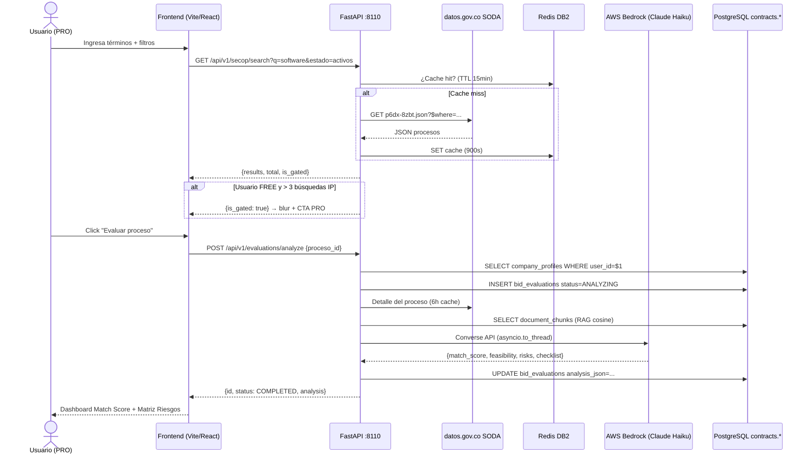
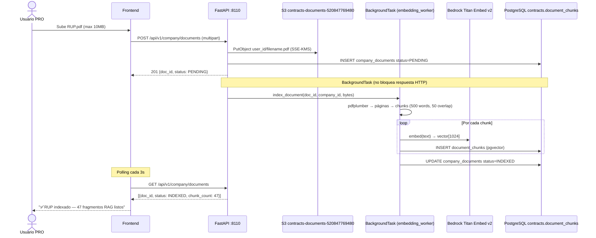
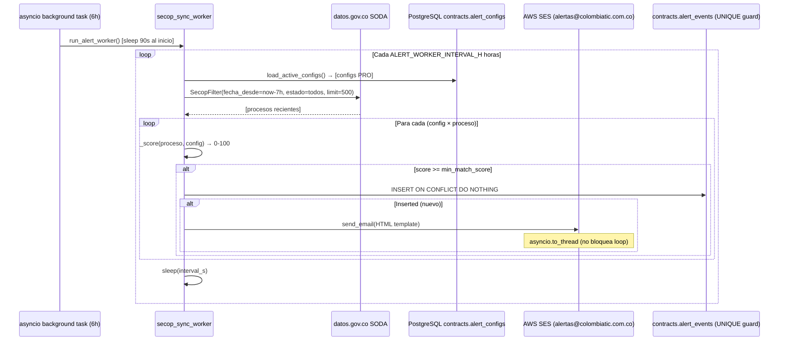
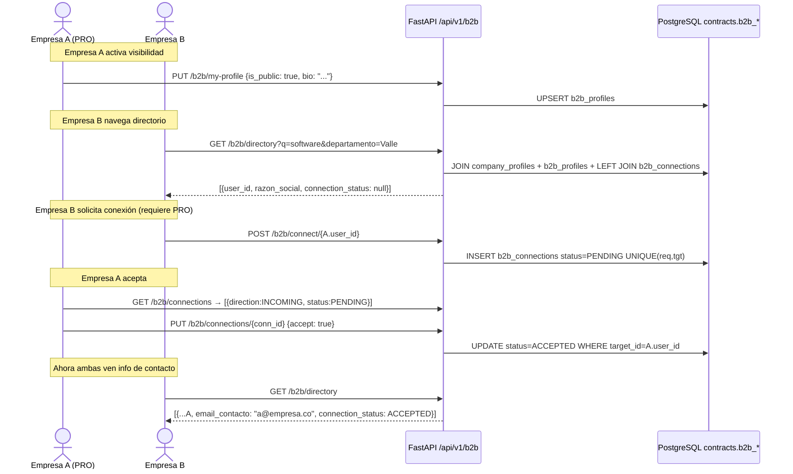
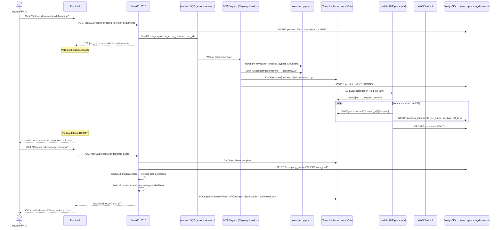
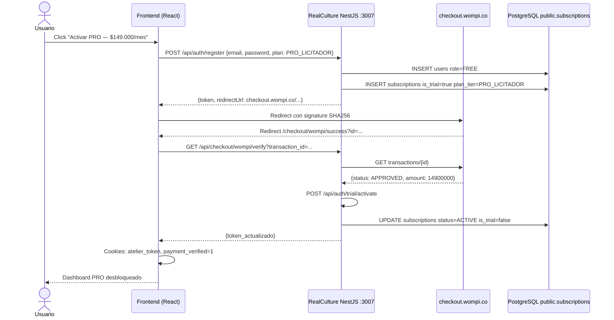
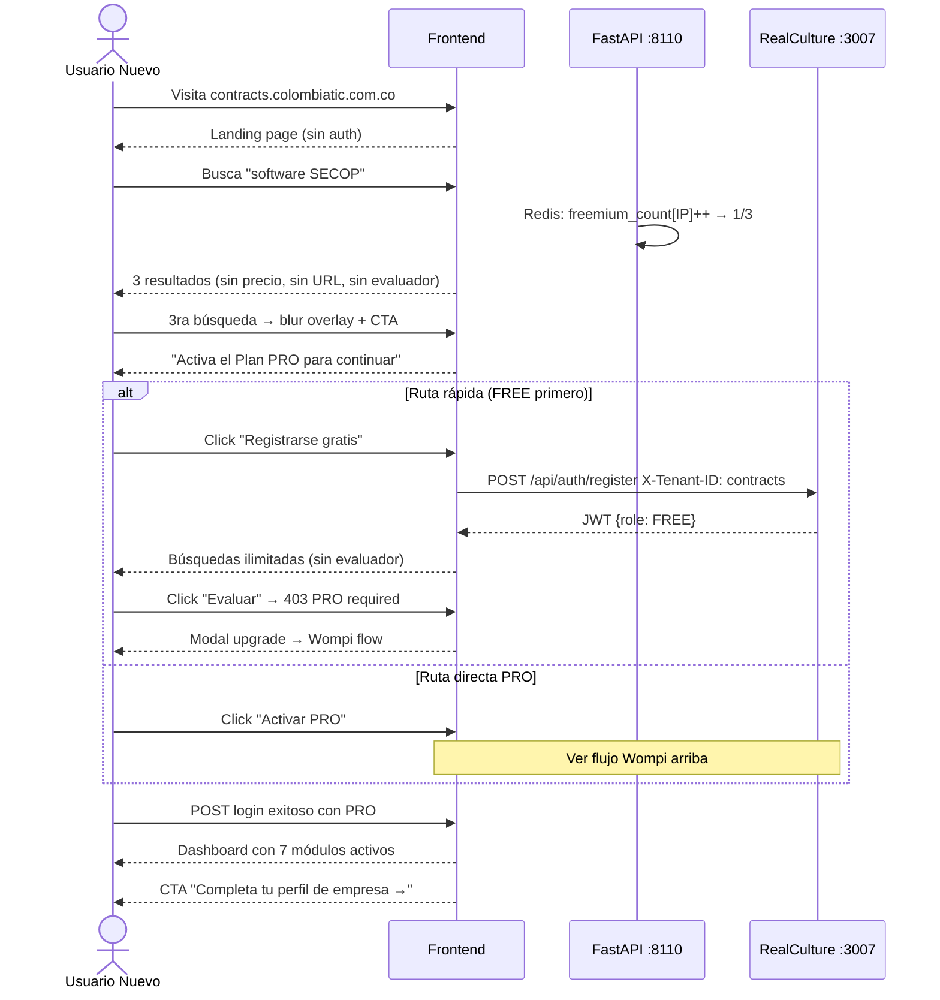
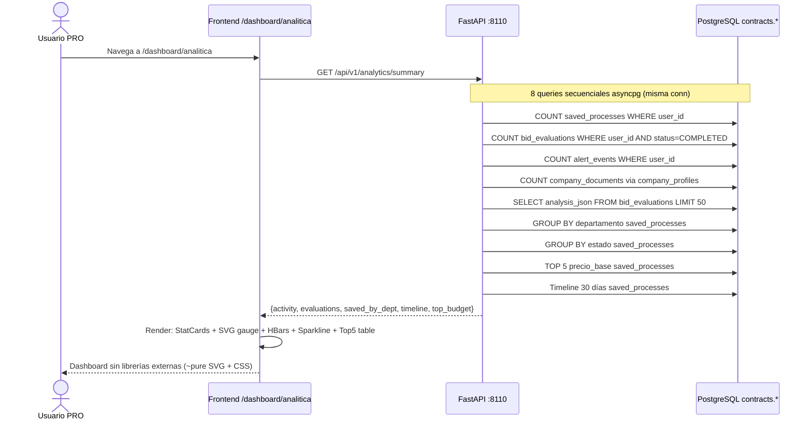

# ColombiaTIC Contracts — Plan Maestro v2.0

> Actualizado: 2026-11-07  
> Fuentes: Análisis de Farolic.app, Manual CCE M-MUDA-02, arquitectura desplegada en VM `184.197.181.224`

---

## 1. Lo que confirma el Manual CCE (M-MUDA-02)

### Hallazgo crítico
La API de datos.gov.co (Socrata SODA) **NO entrega archivos adjuntos**.
Pág. 5 del manual:

> *"Dentro de la información publicada se encuentra la URL que dirige a la página web
> donde se puede ver los documentos del proceso de contratación en el SECOP."*

Es decir: la API solo entrega `urlproceso` — un enlace a la página del proceso.
Los archivos (pliego, formatos Excel, anexos) solo existen en el portal de SECOP II.

### Lo que SÍ tenemos (fuentes de datos)

| Fuente | Qué entrega | Latencia | Archivos |
|--------|-------------|----------|----------|
| `datos.gov.co` SODA API | Metadata estructurada | Diaria | ❌ |
| `api.colombiacompra.gov.co` OCDS | Metadata estructurada estándar internacional | Diaria (4 días lag) | ❌ |
| `www.secop.gov.co` portal | Todo: metadata + archivos ZIP | Tiempo real | ✅ |

### Arquitectura resultante

```
┌──────────────────────────────────────────────────┐
│  CAPA 1 — RADAR (metadata, diaria)               │
│  datos.gov.co SODA → 72.654 procesos activos     │
│  + api.colombiacompra.gov.co OCDS (Sprint 10)    │
└──────────────────────┬───────────────────────────┘
                       │ urlproceso / num_constancia
                       ▼
┌──────────────────────────────────────────────────┐
│  CAPA 2 — EXTRACCIÓN PROFUNDA (bajo demanda)     │
│  secop.gov.co → Playwright → ZIP descargado      │
│  → S3 contracts-deploy-520847769480              │
└──────────────────────┬───────────────────────────┘
                       │ S3 Event → Lambda
                       ▼
┌──────────────────────────────────────────────────┐
│  CAPA 3 — PROCESAMIENTO IA                       │
│  Textract → chunks → Bedrock Claude Haiku        │
│  openpyxl → auto-fill con perfil corporativo     │
└──────────────────────────────────────────────────┘
```

---

## 2. Análisis Competitivo: Farolic vs. ColombiaTIC Contracts

### Precios de Farolic (Nov 2026, beta — subirán con los primeros 10 clientes)

| Plan | Precio/año | Usuarios | Empresas | Feature clave |
|------|-----------|----------|----------|---------------|
| Gratis | $0 | 1 | 1 | Solo búsqueda básica |
| Vigía | **USD $950** (~COP $4M) | 1 | 1 | Radar diario + veredicto |
| Auditor | **USD $1.200** (~COP $5M) | 2 | 1 | + Competencia + MCP |
| Estratega | **USD $2.000** (~COP $8.4M) | 5 | 3 | Multi-empresa |
| A medida | Cotización | N | N | Enterprise |

### Precios actuales de ColombiaTIC Contracts

| Plan | Precio/mes | Precio/año |
|------|-----------|-----------|
| Freemium | $0 | $0 |
| PRO Licitador | $149.000 COP | $1.431.600 COP (~USD $340) |

**Problema: estamos 3× más baratos que Farolic pero aún sin el diferenciador de extracción de documentos.**

### Comparativa funcional

| Característica | Farolic | Contracts (HOY) | Contracts (Target v2) |
|---|:---:|:---:|:---:|
| Búsqueda SECOP II | ✅ | ✅ | ✅ |
| Radar diario alertas | ✅ | ✅ (email) | ✅ (email + WhatsApp) |
| Cruce RUP / UNSPSC | ✅ | ✅ (perfil manual) | ✅ (import RUP PDF) |
| Capacidad residual | ✅ (5 calc.) | ❌ | ✅ Sprint 10 |
| Veredicto aplicabilidad | ✅ binario | ✅ Match Score 0-100 | ✅+ |
| Competencia / historial entidad | ✅ | ❌ | ✅ Sprint 11 |
| MCP para asistentes IA | ✅ | ❌ | ✅ Sprint 12 |
| **Descarga documentos proceso** | ✅ básico | ❌ | ✅ **Sprint 9 (killer)** |
| **Auto-llenado Excel cotización** | ❌ | ❌ | ✅ **Sprint 9 (único)** |
| RAG con documentos empresa | ❌ | ✅ | ✅ |
| Generación borrador propuesta | ❌ | ❌ | ✅ Sprint 11 |
| SIA OBSERVA reporting | ❌ | ❌ | ✅ Sprint 12 |
| Red B2B proveedores | ❌ | ✅ | ✅ |
| Dashboard analítica | ❌ | ✅ | ✅+ |
| Multi-usuario / roles | ✅ (2-5) | ❌ | ✅ Sprint 12 |

### Estrategia de precios v2

```
Plan STARTER      $0          Freemium (3 búsquedas IP, sin evaluador)
Plan PRO          $149.000/mes ($1.431.600/año -20%)   Individual
Plan CORPORATIVO  $390.000/mes ($3.744.000/año -20%)   Hasta 3 usuarios + auto-fill
Plan ENTERPRISE   Cotización                            Multi-empresa + SIA OBSERVA
```

El Plan Corporativo nos posiciona entre Vigía (~COP $4M) y Auditor (~COP $5M) de Farolic,
pero con el diferenciador del **auto-llenado de documentos** que Farolic no tiene.

---

## 3. Diagramas UML (Mermaid)

### 3.1 Flujo de Búsqueda y Evaluación IA



### 3.2 Flujo de Carga de Perfil y RAG (Documentos)



### 3.3 Flujo de Alertas (Worker Periódico)



### 3.4 Flujo de Red B2B



### 3.5 Flujo de Descarga de Documentos SECOP II (Sprint 9 — NUEVO)



### 3.6 Flujo de Pago Wompi



### 3.7 Flujo de Onboarding de Usuario



### 3.8 Flujo de Analítica



---

## 4. Plan Maestro Scrum — Sprints 9–12

### Prioridades estratégicas

1. **Sprint 9** — Descarga SECOP + Auto-fill ← **EL diferenciador competitivo**
2. **Sprint 10** — OCDS API + Capacidad Residual ← cierra brecha con Farolic
3. **Sprint 11** — Generador de Propuestas + Competencia ← supera a Farolic
4. **Sprint 12** — Hardening + Multi-usuario + MCP ← habilita Enterprise

---

### Sprint 9 (2 semanas): Descarga de Documentos SECOP + Auto-fill Excel

**Objetivo**: Descargar el ZIP de documentos de cualquier proceso SECOP II,
extraer, clasificar y pre-llenar automáticamente el Excel de cotización con datos
del perfil corporativo del usuario. Usuario no sabe cómo funciona por dentro.

#### DB — tablas nuevas

```sql
CREATE TABLE contracts.process_fetch_jobs (
    id            UUID PRIMARY KEY DEFAULT gen_random_uuid(),
    proceso_id    VARCHAR(100) NOT NULL,
    user_id       UUID NOT NULL,
    url_proceso   TEXT NOT NULL,
    status        VARCHAR(20) DEFAULT 'QUEUED'
                  CHECK (status IN ('QUEUED','DOWNLOADING','EXTRACTING','READY','FAILED')),
    error_msg     TEXT,
    created_at    TIMESTAMPTZ DEFAULT now(),
    updated_at    TIMESTAMPTZ DEFAULT now()
);

CREATE TABLE contracts.process_documents (
    id            UUID PRIMARY KEY DEFAULT gen_random_uuid(),
    job_id        UUID REFERENCES contracts.process_fetch_jobs(id),
    proceso_id    VARCHAR(100) NOT NULL,
    user_id       UUID NOT NULL,
    file_name     VARCHAR(500) NOT NULL,
    file_type     VARCHAR(20) NOT NULL  -- EXCEL_TEMPLATE, PDF_PLIEGO, PDF_ANEXO, OTHER
                  CHECK (file_type IN ('EXCEL_TEMPLATE','PDF_PLIEGO','PDF_ANEXO','OTHER')),
    s3_key        TEXT NOT NULL,
    file_size_kb  INTEGER,
    created_at    TIMESTAMPTZ DEFAULT now()
);

CREATE TABLE contracts.generated_quotes (
    id            UUID PRIMARY KEY DEFAULT gen_random_uuid(),
    proceso_id    VARCHAR(100) NOT NULL,
    user_id       UUID NOT NULL,
    source_doc_id UUID REFERENCES contracts.process_documents(id),
    s3_key        TEXT NOT NULL,
    fill_pct      INTEGER DEFAULT 0,
    cell_mapping  JSONB,  -- {"A3": "razon_social", "B5": "nit", ...}
    status        VARCHAR(20) DEFAULT 'PROCESSING'
                  CHECK (status IN ('PROCESSING','READY','FAILED')),
    generated_at  TIMESTAMPTZ DEFAULT now()
);
```

#### Tasks Sprint 9

| ID | Task | Habilitador | Prioridad |
|----|------|-------------|-----------|
| S9-T1 | Crear script DB `create_sprint9_tables.py` + ejecutar en VM | asyncpg directo a RDS | P0 |
| S9-T2 | Implementar `secop_playwright_downloader.py` — ECS Fargate container: recibe `{proceso_id, url_proceso}`, bypass Cloudflare con `curl_cffi impersonate=chrome`, localiza enlace ZIP, descarga, sube a `s3://.../raw/{proceso_id}/docs.zip` | `curl_cffi` (pip) en container Docker; S3 PutObject | P0 |
| S9-T3 | Implementar `zip_extractor_lambda.py` — triggered por S3 event `*.zip` en `raw/`: unzip en memoria, clasifica por extensión y nombre, sube cada archivo a `extracted/`, inserta `process_documents` | `zipfile`, `boto3`, asyncpg | P0 |
| S9-T4 | Implementar `template_autofiller.py` — lee Excel con `openpyxl`, detecta celdas con strings como "EMPRESA", "NIT", "REPRESENTANTE", inyecta datos del `company_profiles`, guarda `generated_quotes` | `openpyxl`, Bedrock Claude (para celdas ambiguas) | P0 |
| S9-T5 | API: `POST /api/v1/process/{id}/fetch-documents` — encola en SQS, retorna `job_id` inmediato | SQS `secop-docs-jobs`, FastAPI BackgroundTasks fallback | P0 |
| S9-T6 | API: `GET /api/v1/process/{id}/documents` — lista archivos descargados con presigned URLs S3 (15min) | asyncpg, S3 generate_presigned_url sigv4 | P0 |
| S9-T7 | API: `POST /api/v1/process/{id}/generate-quote` — llama `template_autofiller`, retorna URL de descarga | asyncpg, S3 | P0 |
| S9-T8 | API: `GET /api/v1/process/jobs/{job_id}` — status polling | asyncpg | P1 |
| S9-T9 | Frontend: `ProcesoWorkspacePage.tsx` en `/dashboard/workspace/{proceso_id}` con: resumen proceso, botón "Obtener documentos", lista de archivos con iconos por tipo, botón "Generar cotización", progress states con mensajes amigables | Vite/React, `useAuthStore` | P0 |
| S9-T10 | Frontend: agregar botón "Abrir workspace" en `ProcessDetailModal` | `ResultCard`, `ProcessDetailModal` | P1 |
| S9-T11 | Frontend: ruta `/dashboard/workspace` en `DashboardPage` | React Router | P1 |
| S9-T12 | Pricing: agregar Plan Corporativo $390.000/mes en `pricing.ts` y en backend `plan-catalog.ts` | `CORPORATIVO` en `_PRO_PLANS` set | P2 |
| S9-T13 | IAM: policy SQS `send/receive/delete` para rol VM + Lambda execution role | `infra-aws/contracts/iam/sqs-policy.json` | P0 |
| S9-T14 | Infra: Dockerfile Playwright container + ECR repo + ECS Task Definition (0.5 vCPU, 1GB, Fargate SPOT) | `infra-aws/contracts/ecs/` | P0 |
| S9-T15 | Tests: 5 procesos reales con Excel adjunto — validar ZIP → extract → autofill pipeline | pytest asyncio + fixtures | P1 |

#### Criterios de Done Sprint 9
- [ ] Pipeline descarga → extracción → autofill funciona end-to-end para ≥3 tipos de Excel de entidades distintas
- [ ] `fill_pct >= 70%` en promedio sobre casos de prueba
- [ ] Usuario en frontend ve estados progresivos ("Descargando…", "Analizando…", "Listo") sin pantalla en blanco
- [ ] Presigned URL expira en 15min (no expone datos de otros usuarios)
- [ ] Logs de auditoría en CloudTrail (quién descargó qué proceso)

---

### Sprint 10 (2 semanas): OCDS API + Capacidad Residual + Historial Entidad

**Objetivo**: Usar `api.colombiacompra.gov.co` como fuente complementaria para datos
más ricos (adjudicaciones, contratos en ejecución) y calcular la Capacidad Residual
del usuario (killer feature de Farolic que aún no tenemos).

#### Tasks Sprint 10

| ID | Task | Habilitador | Prioridad |
|----|------|-------------|-----------|
| S10-T1 | Implementar `ocds_gateway.py` — cliente httpx para `api.colombiacompra.gov.co/releases/` con parámetros `num_constancia`, `items` (UNSPSC), `start/finish`, `status` | `httpx`, cache Redis 4h | P0 |
| S10-T2 | DB: tabla `capacity_snapshots` — registra contratos en ejecución del usuario por NIT (manualmente o importado de SECOP I por NIT) | asyncpg, OCDS API `/releases/contract/?identifier={nit}` | P0 |
| S10-T3 | Lógica de Capacidad Residual: `K_residual = K_total − Σ(contratos_activos)`. Comparar vs `precio_base` proceso evaluado → semáforo VERDE/AMARILLO/ROJO | `company_profiles.capacidad_k` | P0 |
| S10-T4 | Integrar `K_residual` en el resultado de `evaluate_bid.py` como campo adicional en `analysis_json` | Bedrock prompt + lógica Python | P0 |
| S10-T5 | API: `GET /api/v1/process/{id}/entity-history` — historial de contratos de la entidad compradora desde OCDS (últimos 24 meses) | OCDS API `/releases/?name={entidad}` | P1 |
| S10-T6 | Frontend: `CapacidadResidualCard.tsx` en `EvaluacionesPage` y en el workspace — muestra K total, K en uso, K disponible, semáforo | SVG gauge reutilizado de `AnalyticaPage` | P0 |
| S10-T7 | Frontend: `HistorialEntidadSection.tsx` en `ProcessDetailModal` — tabla top 5 contratos adjudicados por esa entidad | OCDS endpoint | P1 |
| S10-T8 | Import RUP PDF: `POST /api/v1/company/import-rup` — sube PDF del RUP, Textract extrae UNSPSC, capacidad K, experiencia, auto-llena `company_profiles` | AWS Textract, Bedrock para parseado | P1 |
| S10-T9 | Dashboard analítica: añadir "Capacidad utilizada" — barra K_residual vs K_total | `get_analytics.py` | P2 |
| S10-T10 | Actualizar prompt de evaluación en Bedrock para incluir `K_residual` en el análisis de factibilidad económica | `evaluate_bid.py` _SYSTEM_PROMPT | P1 |

---

### Sprint 11 (2 semanas): Generador de Propuestas + Análisis de Competencia

**Objetivo**: Pasar de "cotización pre-llenada" a "borrador de propuesta técnica"
generado por IA, y agregar historial de competidores que cierra la brecha con Farolic Auditor.

#### Tasks Sprint 11

| ID | Task | Habilitador | Prioridad |
|----|------|-------------|-----------|
| S11-T1 | `proposal_generator.py` — usa Bedrock Claude Sonnet para generar borrador de propuesta técnica a partir de: pliego PDF (Textract), perfil empresa RAG, evaluación previa | Bedrock Converse API, RAG chunks | P0 |
| S11-T2 | Plantilla PDF de propuesta con `reportlab` — logo empresa (desde S3 o placeholder), datos corporativos, tabla de ítems, metodología IA-generada, firma | `reportlab` o `weasyprint` | P0 |
| S11-T3 | API: `POST /api/v1/process/{id}/generate-proposal` — async, retorna `job_id`, genera PDF en background | FastAPI BackgroundTasks | P0 |
| S11-T4 | DB: tabla `generated_proposals` similar a `generated_quotes` con campo `word_count`, `sections_json` | asyncpg | P0 |
| S11-T5 | `competitor_analyzer.py` — usa OCDS `/releases/award/?items={unspsc}` para encontrar empresas que han ganado contratos similares en la región | OCDS API | P1 |
| S11-T6 | API: `GET /api/v1/process/{id}/competitors` — top 5 proveedores que han ganado contratos similares | OCDS + asyncpg cache | P1 |
| S11-T7 | Frontend: `ProposalSection.tsx` en workspace — botón "Generar borrador propuesta", preview, descarga PDF | React, polling | P0 |
| S11-T8 | Frontend: `CompetidoresSection.tsx` — cards de competidores con nombre, NIT, # contratos ganados, valor total | OCDS endpoint | P1 |
| S11-T9 | Plan Corporativo: desbloquear workspace, generador propuesta, historial competidores para `CORPORATIVO` tier | `require_pro` → `require_pro_or_corp` helper | P0 |
| S11-T10 | Email de bienvenida (SES) al activar PRO/Corporativo con onboarding checklist | `manage_alerts.py` pattern | P2 |

---

### Sprint 12 (2 semanas): Hardening + Multi-usuario + MCP Server

**Objetivo**: RLS en PostgreSQL, multi-usuario para Corporativo, MCP server para
integración con Claude/Cursor/ChatGPT de los usuarios, y preparación Enterprise.

#### Tasks Sprint 12

| ID | Task | Habilitador | Prioridad |
|----|------|-------------|-----------|
| S12-T1 | RLS (Row Level Security): `ALTER TABLE contracts.* ENABLE ROW LEVEL SECURITY` + policies `user_id = current_setting('app.user_id')` | PostgreSQL RLS, asyncpg `set_session_attributes` | P0 |
| S12-T2 | Multi-usuario: tabla `org_members` — `{org_id, user_id, role: ADMIN/MEMBER/VIEWER}`. Org comparte `company_profiles`, `process_documents`, `generated_quotes` | asyncpg, JWT org_id claim | P0 |
| S12-T3 | Plan Corporativo: hasta 3 usuarios en misma org, ADMIN puede invitar por email (SES) | `org_members`, SES invite flow | P0 |
| S12-T4 | MCP Server: endpoint `GET /mcp/tools` + `POST /mcp/tool/{name}` — expone: `buscar_procesos`, `evaluar_proceso`, `obtener_documentos`, `ver_conexiones_b2b`, `verificar_capacidad_residual` | FastAPI, MCP protocol JSON schema | P1 |
| S12-T5 | MCP auth: API keys por usuario, tabla `api_keys` con hash SHA256 | asyncpg, `secrets.token_hex(32)` | P1 |
| S12-T6 | Rate limiting global: `slowapi` en FastAPI + Redis para 100 req/min por usuario PRO | `slowapi`, Redis | P0 |
| S12-T7 | Audit log: tabla `audit_log` — INSERT on every sensitive action (download, generate, connect) vía FastAPI middleware | asyncpg, CloudTrail complement | P1 |
| S12-T8 | SIA OBSERVA (Enterprise): `sia_reporter.py` — mapea contrato SECOP activo → campos SIA OBSERVA. Auto-completa formato mensual de ejecución. Inicialmente exporta Excel, luego integración directa | openpyxl, OCDS contract data | P2 |
| S12-T9 | Nginx: rate limiting por IP + fail2ban config en VM para proteger :8110 | `infra-aws/contracts/nginx/` | P0 |
| S12-T10 | Monitoring: CloudWatch custom metrics para `evaluations_per_day`, `documents_downloaded`, `active_pro_users`. Alarma si API p99 > 5s | boto3 CloudWatch, `main.py` middleware | P1 |
| S12-T11 | Load test: `locust` contra staging — 50 usuarios concurrentes durante 5 min | `locust`, EC2 separado | P1 |

---

## 5. Cronograma y Esfuerzo

```
Semana 1-2   Sprint 9  — Extracción documentos SECOP + Auto-fill
Semana 3-4   Sprint 10 — OCDS + Capacidad Residual
Semana 5-6   Sprint 11 — Generador propuestas + Competidores
Semana 7-8   Sprint 12 — Hardening + Multi-usuario + MCP
```

## 6. Costos AWS estimados (por mes post-Sprint 9)

| Servicio | Uso estimado | Costo/mes |
|----------|-------------|-----------|
| ECS Fargate (Playwright worker) | 200h × 0.5vCPU × $0.04/h | ~$8 |
| Lambda (ZIP processor, quote generator) | 5000 invocaciones | ~$2 |
| S3 (raw + processed docs) | 20 GB | ~$0.46 |
| SQS | 50K mensajes | ~$0.03 |
| Textract (PDF pliego) | 100 PDFs × 20 pág | ~$1.50 |
| Bedrock Claude Haiku (evaluaciones + autofill) | 500 calls | ~$30 |
| SES (alertas) | 2000 emails | ~$0.20 |
| **Total incremental Sprint 9** | | **~$42/mes** |
| Total acumulado (todos los módulos) | | **~$167/mes** |

Con 15 usuarios Corporativo ($390k COP/mes = ~USD $93/mes cada uno)
→ **MRR: USD $1,395 — margen bruto: ~94%**

---

## 7. Resumen Ejecutivo: Por qué ganamos a Farolic

| Dimensión | Farolic | ColombiaTIC Contracts v2 |
|---|---|---|
| **Precio entrada** | USD $950/año (~COP $4M) | COP $1.4M PRO / $3.7M Corporativo |
| **Descarga documentos** | Básico (manual) | **Automático, en background, invisible** |
| **Auto-fill cotización** | ❌ No existe | ✅ **Único en el mercado** |
| **Generación propuesta** | ❌ | ✅ Borrador IA en 60 segundos |
| **RAG con documentos empresa** | ❌ | ✅ Embeddings pgvector |
| **Red B2B** | ❌ | ✅ Directorio opt-in con conexiones |
| **Capacidad Residual** | ✅ (5 calc.) | ✅ Sprint 10 |
| **Competidores** | ✅ Auditor | ✅ Sprint 11 |
| **MCP para IA assistants** | ✅ Auditor | ✅ Sprint 12 |
| **SIA OBSERVA** | ❌ | ✅ Sprint 12 Enterprise |

**Nuestra propuesta de valor única:**  
*"No solo te decimos si puedes aplicar — te preparamos para ganar."*

Farolic es un **pre-auditor** (semáforo).  
ColombiaTIC Contracts es un **copiloto de licitaciones** (de la detección al contrato firmado).
