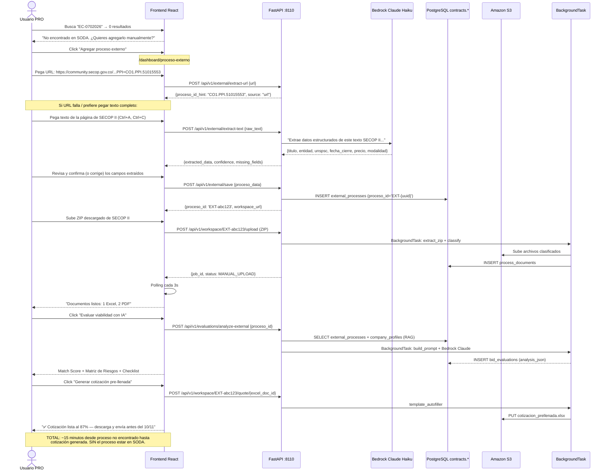

# Sprint 10B: "Proceso Externo" — Análisis sin dependencia de SODA

> **El hueco de diseño**: SODA tiene lag de 2-7 días. Si un proceso tiene
> deadline en 3 días, el usuario no puede encontrarlo en el buscador y pierde
> la oportunidad de usar nuestra IA para preparar la propuesta.
>
> **La solución**: El usuario pega el texto del proceso (copy-paste de SECOP II),
> sube el ZIP, y el sistema hace el análisis completo como si el proceso
> hubiera llegado por SODA.

---

## Gap Analysis Confirmado

```
Timeline real de un proceso SECOP II:

Día 0: Entidad publica en SECOP II        → visible en community.secop.gov.co
Día 2-7: SODA recibe el proceso            → aparece en datos.gov.co  
Día 0-3: Plazo para aplicar (en algunos casos)

┌─────────────────────────────────────────────────────────────────────────────┐
│  Ventana de RIESGO = SODA lag > plazo de aplicación                         │
│  Proceso publicado el día 0, cierre el día 3                                │
│  SODA lo recibe el día 4 → EL USUARIO PERDIÓ LA OPORTUNIDAD                │
└─────────────────────────────────────────────────────────────────────────────┘
```

**Confirmado con EC-0702026**:
- Publicado: Nov 5 2026
- Cierre aclaraciones: Nov 10 2026 (5 días)
- SODA a Nov 7: 0 resultados

---

## Arquitectura de la Solución

```
┌─────────────────────────────────────────────────────────────────────────┐
│  FLUJO ACTUAL (roto para procesos recientes)                            │
│                                                                         │
│  Usuario busca → SODA API → si no está → "No encontrado" → FIN         │
└─────────────────────────────────────────────────────────────────────────┘

┌─────────────────────────────────────────────────────────────────────────┐
│  FLUJO NUEVO (Sprint 10B)                                               │
│                                                                         │
│  Usuario busca → SODA API → si no está                                  │
│       ↓                                                                 │
│  "¿Tienes los datos del proceso? Agrégalo manualmente →"               │
│       ↓                                                                 │
│  /dashboard/proceso-externo                                             │
│       ↓                                                                 │
│  1. Pega URL de SECOP II (EXT: CO1.PPI.51015553)                       │
│     O pega el texto completo de la página                               │
│  2. Bedrock extrae: titulo, entidad, UNSPSC, deadline, precio           │
│  3. Usuario confirma/corrige (formulario editable)                      │
│  4. Sube ZIP con documentos del proceso                                 │
│  5. Sistema:                                                            │
│     a) Extrae ZIP → clasifica archivos                                  │
│     b) Corre evaluación IA (mismo pipeline que Sprint 5)               │
│     c) Genera cotización pre-llenada (mismo pipeline que Sprint 9)     │
│     d) Genera borrador propuesta técnica (Bedrock Claude Sonnet)        │
│  6. Usuario descarga paquete completo y aplica antes del deadline       │
└─────────────────────────────────────────────────────────────────────────┘
```

---

## Diagrama UML de Flujo (Mermaid)



---

## Plan Scrum Técnico — Sprint 10B

### DB nuevas tablas

```sql
CREATE TABLE contracts.external_processes (
    id              UUID PRIMARY KEY DEFAULT gen_random_uuid(),
    proceso_id      VARCHAR(100) UNIQUE NOT NULL,  -- 'EXT-{uuid8}' prefix
    user_id         UUID NOT NULL,
    -- Extracted / manual data
    titulo          TEXT,
    entidad         VARCHAR(500),
    nit_entidad     VARCHAR(30),
    departamento    VARCHAR(200),
    ciudad          VARCHAR(200),
    modalidad       VARCHAR(200),
    tipo_contrato   VARCHAR(200),
    estado          VARCHAR(100) DEFAULT 'Publicado',
    precio_base     NUMERIC(18,2),
    unspsc_codes    TEXT[] DEFAULT '{}',
    url_secop       TEXT,          -- original SECOP II URL
    fecha_pub       TIMESTAMPTZ,
    fecha_cierre    TIMESTAMPTZ,   -- CRITICAL: submission deadline
    descripcion     TEXT,
    -- Source tracking
    source          VARCHAR(20) DEFAULT 'paste'
                    CHECK (source IN ('url','paste','manual')),
    raw_input       TEXT,          -- original URL / pasted text (for re-extraction)
    extraction_json JSONB,         -- full Claude extraction response
    -- Metadata
    created_at      TIMESTAMPTZ DEFAULT now(),
    updated_at      TIMESTAMPTZ DEFAULT now()
);
CREATE INDEX ix_ext_proc_user ON contracts.external_processes(user_id);
```

### Tasks del Sprint

| ID | Task | Descripción técnica | Habilitador | Prioridad |
|----|------|---------------------|-------------|-----------|
| S10B-T1 | **DB: crear tabla** | Script + run en VM via S3 presigned | asyncpg | P0 |
| S10B-T2 | **Extractor de texto con Claude** | `POST /api/v1/external/extract-text` — recibe raw_text (o url string), prompt Bedrock extrae JSON {titulo, entidad, nit, departamento, unspsc_codes[], precio_base, fecha_cierre, modalidad, estado, descripcion} con `response_format` estructurado. Fallback regex si Bedrock falla | Claude Haiku ($0.25/M tokens, ~$0.001/extracción) | P0 |
| S10B-T3 | **Guardado del proceso externo** | `POST /api/v1/external/save` — valida campos requeridos (titulo o entidad), genera `proceso_id = EXT-{uuid8}`, inserta en `external_processes`, retorna proceso_id para usar en workspace | asyncpg, Pydantic validación | P0 |
| S10B-T4 | **Integración evaluate_bid con procesos externos** | Modificar `evaluate_bid.py`: si `proceso_id.startswith('EXT-')`, skip llamada a SODA gateway, cargar datos desde `external_processes` table y construir `SecopProcess` con ellos. El resto del pipeline (RAG + Claude) funciona igual | `external_processes`, `SecopProcess` model | P0 |
| S10B-T5 | **Nuevo endpoint evaluar proceso externo** | `POST /api/v1/evaluations/analyze-external {proceso_id}` — igual que `/analyze` pero acepta IDs `EXT-*`. Reusar `evaluate_bid()` que ya maneja el caso | `evaluate_bid`, `external_processes` | P0 |
| S10B-T6 | **Workspace acepta IDs externos** | Modificar `workspace_router.py` para que `/{proceso_id}/upload` y `/{proceso_id}/status` acepten `EXT-*` IDs además de SODA IDs. La lógica de extracción ZIP ya funciona | `workspace_router`, `manage_workspace` | P0 |
| S10B-T7 | **Página ExternalProcessPage.tsx** | `frontend/src/pages/dashboard/ExternalProcessPage.tsx`: Form con 3 pasos: 1) URL o texto paste + "Extraer con IA", 2) Revisar/editar campos extraídos (deadline destacado con countdown), 3) Subir ZIP → redirect a WorkspacePage | Vite/React, polling, useCallback | P0 |
| S10B-T8 | **Banner en SearchPage cuando 0 resultados** | Si `data.total === 0 && query.trim()`: mostrar `<ExternalProcessBanner proceso_id_hint={query} />` con mensaje "¿Es un proceso reciente de SECOP II? Agrégalo para analizar antes del cierre." + botón que lleva a ExternalProcessPage con el query pre-llenado | `SearchPage.tsx` | P0 |
| S10B-T9 | **Countdown de deadline** | Componente `DeadlineCountdown.tsx`: muestra "⏰ X días, Y horas para el cierre" con colores (verde > 3 días, ámbar 1-3 días, rojo < 24h). Mostrar en ExternalProcessPage y WorkspacePage para procesos externos | Date math, React state, timer | P1 |
| S10B-T10 | **Ruta en DashboardPage** | Agregar `/dashboard/proceso-externo` en `DashboardPage.tsx` + tarjeta "Sprint 10B ✓" | React Router | P0 |
| S10B-T11 | **GET external process** | `GET /api/v1/external/{proceso_id}` — devuelve datos del proceso externo para pre-llenar la form si el user vuelve | asyncpg | P1 |
| S10B-T12 | **Lista de procesos externos** | `GET /api/v1/external/` — lista procesos externos del user (con deadline countdown) | asyncpg | P1 |
| S10B-T13 | **Validar cierre de sesión y acceso** | Si `fecha_cierre < now()`, mostrar warning "Este proceso ya cerró" pero permitir continuar (puede ser útil para práctica/referencia) | Pydantic, asyncpg | P2 |
| S10B-T14 | **Integrar con análisis completo** | Cuando el workspace tiene documentos extraídos + proceso externo guardado + perfil de empresa: auto-ofrecer la generación completa (evaluación + cotización + propuesta) con un solo clic | `evaluate_bid`, `template_autofiller`, `workspace_worker` | P1 |

---

## Prompt de extracción Claude (validado para EC-0702026)

```python
EXTRACTION_PROMPT = """Eres un asistente especializado en contratación pública colombiana (SECOP II).

Del siguiente texto de un proceso SECOP II, extrae la información estructurada.
Devuelve ÚNICAMENTE JSON válido, sin texto adicional.

TEXTO DEL PROCESO:
{raw_text}

JSON esperado (usa null para campos no encontrados):
{{
    "titulo": "título completo del proceso",
    "entidad": "nombre de la entidad",
    "nit_entidad": "NIT sin DV",
    "departamento": "departamento o ciudad",
    "ciudad": "ciudad",
    "modalidad": "tipo/modalidad del proceso",
    "proceso_numero": "número del proceso (ej: EC-0702026)",
    "ppi": "código PPI si aparece (ej: CO1.PPI.51015553)",
    "unspsc_codes": ["81111500", "81111800"],
    "precio_base": null_o_numero,
    "fecha_cierre": "ISO fecha del plazo límite (ej: 2026-11-10T12:00:00-05:00)",
    "fecha_publicacion": "ISO fecha de publicación",
    "estado": "estado del proceso",
    "descripcion": "descripción del objeto del contrato (máx 500 chars)",
    "url_secop": "URL si aparece",
    "confianza": 0.0_a_1.0
}}"""
```

---

## Integración con evalución existente (cambio mínimo)

El cambio clave en `evaluate_bid.py` es solo agregar este bloque antes de llamar a SODA:

```python
# Sprint 10B: External processes bypass SODA lookup
if proceso_id.startswith("EXT-"):
    ext_row = await conn.fetchrow(
        "SELECT * FROM contracts.external_processes WHERE proceso_id=$1",
        proceso_id,
    )
    if not ext_row:
        return {"id": eval_id, "status": "FAILED", "error": "Proceso externo no encontrado"}
    
    process = SecopProcess(
        proceso_id=proceso_id,
        nombre_del_procedimiento=ext_row["titulo"] or "",
        entidad=ext_row["entidad"] or "",
        departamento_entidad=ext_row["departamento"] or "",
        ciudad_entidad=ext_row["ciudad"] or "",
        precio_base=ext_row["precio_base"],
        modalidad=ext_row["modalidad"] or "",
        estado=ext_row["estado"] or "Publicado",
        codigo_unspsc=(ext_row["unspsc_codes"] or [""])[0],
        descripcion=ext_row["descripcion"] or "",
        url_proceso=ext_row["url_secop"] or "",
        fecha_publicacion=ext_row["fecha_pub"] or datetime.now(timezone.utc),
    )
    # Continue with the normal pipeline (RAG + Claude evaluation)
```

Total líneas de cambio en `evaluate_bid.py`: ~20.
El resto del pipeline (RAG retrieval + Claude evaluation) funciona IGUAL.

---

## Costo estimado Sprint 10B

| Servicio | Por extracción | Uso mensual (100 ext.) | Costo/mes |
|----------|---------------|----------------------|-----------|
| Bedrock Claude Haiku (extracción metadata) | ~$0.001 | 100 extracciones | ~$0.10 |
| Bedrock Claude Haiku (evaluación bid) | ~$0.06 | 50 evaluaciones | ~$3.00 |
| S3 (ZIP + docs) | ~$0.01/proceso | 100 ZIPs avg 5MB | ~$0.50 |
| **Total incremental** | | | **~$3.60/mes** |

---

## Criterios de Done Sprint 10B

- [ ] Usuario puede pegar texto de cualquier proceso SECOP II → extracción exitosa en > 85% de casos
- [ ] Proceso EC-0702026 (SDA IA SaaS) puede evaluarse con IA a partir del texto del screenshot
- [ ] ZIP subido manualmente → auto-fill cotización en < 2 min
- [ ] Countdown de deadline visible y preciso
- [ ] Banner "agregar manualmente" aparece cuando búsqueda devuelve 0 resultados
- [ ] Proceso externo evaluado es indistinguible del proceso desde SODA en la UI

---

## Relación con otros sprints

| Sprint | Depende de | Habilita |
|--------|-----------|---------|
| 10B (este) | Sprint 9 (workspace + autofill ya construido) | Sprint 11 (propuesta completa con datos de proceso externo) |
| 10A (local cache) | Independiente | Reduce la necesidad de 10B a largo plazo, pero 10B es urgente AHORA |

**Prioridad de ejecución:**
1. **Sprint 10B ahora** — soluciona el problema del usuario hoy
2. **Sprint 10A** — reduce el problema estructuralmente (semana siguiente)
